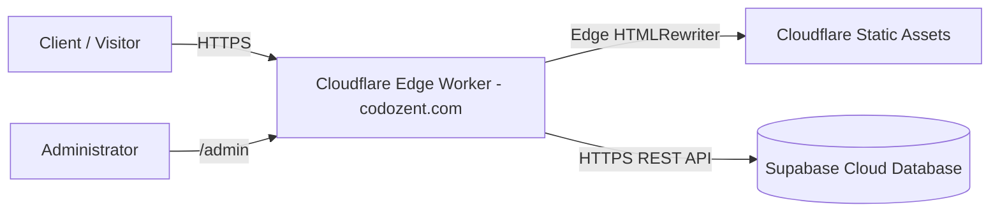

# Codozent Technologies - Official Website & Cloudflare Edge CMS

Modern, high-performance digital platform for **Codozent Technologies**, powered by **Cloudflare Edge Workers** and **Supabase**:
- **Edge Architecture**: 100% serverless on Cloudflare Edge Worker (`_worker.js`) with 0ms cold starts and global distribution across 330+ locations.
- **Edge Server-Side Rendering (SSR)**: Dynamic SEO hydration using Cloudflare `HTMLRewriter` for instant live content synchronization.
- **Direct Supabase Integration**: REST API connectivity directly from edge nodes with zero database connection pooler bottlenecks.
- **Integrated Admin CMS**: Full-featured admin dashboard accessible at `/admin` for updating homepage video, imagery, blogs, and career listings.
- **Security-First**: Zero credentials in source code or Git history. All secrets are managed via Cloudflare Environment Variables & Secrets.

---

## Architecture Overview



---

## Quick Links

- [DEPLOYMENT_GUIDE.md](DEPLOYMENT_GUIDE.md) - Complete guide for setting up Cloudflare environment variables, custom domain, and admin access.
- [SUPABASE_SETUP_GUIDE.md](SUPABASE_SETUP_GUIDE.md) - Supabase schema and database instructions.

---

## Environment Variables (Cloudflare Dashboard)

Set these 5 variables in your Cloudflare Worker project settings (**Settings** -> **Variables and Secrets**):

1. `SUPABASE_URL`: Your Supabase Project URL (`https://[YOUR-PROJECT-REF].supabase.co`)
2. `SUPABASE_KEY`: Your Supabase `service_role` (or `anon`) key
3. `ADMIN_EMAIL`: `codozent.help@gmail.com`
4. `ADMIN_PASSWORD`: Your admin login password
5. `CMS_SECRET_KEY`: Random 32+ character string for JWT session encryption

---

## Health Check

To verify edge worker status and live database connectivity:
```text
GET https://codozent.com/api/health
```

---

## License

Private & Proprietary - Codozent Technologies. All rights reserved.
