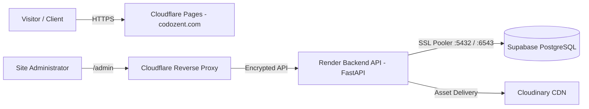

# Codozent Technologies - Official Website & CMS

Modern, high-performance digital platform for **Codozent Technologies**, built with a hybrid production architecture:
- **Frontend**: Clean semantic HTML5, CSS3, modern JavaScript, optimized for Cloudflare Pages (Global CDN, 100% uptime).
- **Backend & CMS**: Python FastAPI service with full headless CMS capabilities, hosted on Render.com.
- **Database**: Supabase Cloud PostgreSQL with SSL transaction pooling.
- **Media & Assets**: Cloudinary CDN with automatic WebP conversion and responsive delivery.

---

## Architecture Overview



---

## Deployment Setup

For detailed instructions on deploying this project on **Render** and **Cloudflare Pages**, see:
- [DEPLOYMENT_GUIDE.md](DEPLOYMENT_GUIDE.md) - End-to-end deployment instructions
- [SUPABASE_SETUP_GUIDE.md](SUPABASE_SETUP_GUIDE.md) - Supabase cloud database configuration

---

## Local Development

1. Create and activate a Python virtual environment:
   ```bash
   python -m venv venv
   source venv/bin/activate  # Or on Windows: .\venv\Scripts\activate
   ```

2. Install dependencies:
   ```bash
   pip install -r requirements.txt
   ```

3. Configure your `.env` file with your Supabase credentials (see `.env.example`).

4. Start the development server:
   ```bash
   python -m uvicorn cms.server:app --host 127.0.0.1 --port 8000 --reload
   ```

5. Access the application:
   - **Public Website**: `http://127.0.0.1:8000/`
   - **Admin CMS Panel**: `http://127.0.0.1:8000/admin`
   - **API Health Check**: `http://127.0.0.1:8000/api/health`

---

## License

Private & Proprietary - Codozent Technologies. All rights reserved.
